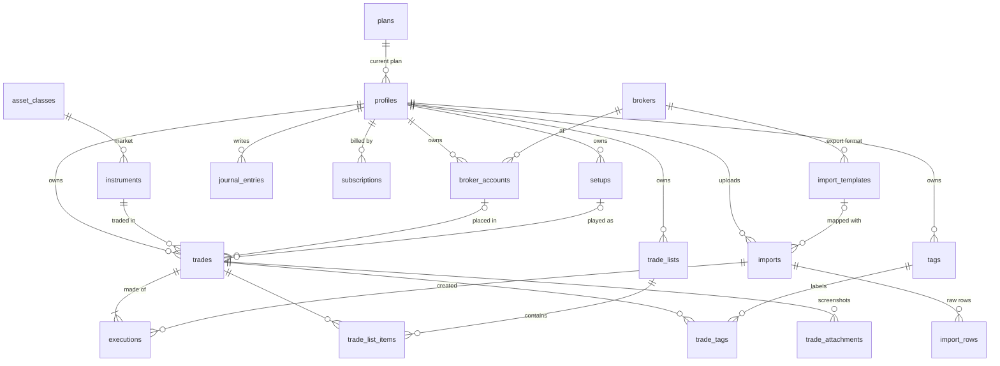

# TradeLab database

Postgres on Supabase. The schema lives in `supabase/migrations/` and is applied in filename order.

| Migration | What it adds |
| --- | --- |
| `..._foundation.sql` | Reference tables: plans, markets, brokers, futures contract specs |
| `..._core_tables.sql` | Profiles, broker accounts, instruments, trades, executions, lists, setups, tags, journal, screenshots |
| `..._imports.sql` | Broker import templates, import batches, raw import rows |
| `..._business_logic.sql` | Profile on sign-up, trade list limit, instrument lookup, trade P&L calculation |
| `..._security.sql` | Row level security and column privileges |
| `..._storage.sql` | Private storage buckets for screenshots and uploaded broker files |
| `..._analytics.sql` | Stats, daily P&L / equity curve, performance breakdowns |

## Diagram



## Key ideas

**A trade is built from its executions.** Users never type P&L. Manual entry and imports both create
fills in `executions`, and a trigger recalculates the parent trade: size, average entry and exit,
gross and net P&L, fees, status, open and close time. Scaling in and out, partial closes and editing a
fill all stay correct automatically. Calculated columns can't be written by the client.

**Markets.** Each trade copies `asset_class` (stock, option, future, crypto) from its instrument, so
every market tab and its analytics is one indexed filter. Adding forex later is one `INSERT` into
`asset_classes`.

**Instruments are shared and normalized.** `get_or_create_instrument()` is the only way to create one.
Options are stored under their OCC symbol whether the broker sent the OCC string or separate
strike/expiry/type fields, and get a 100 multiplier. Futures contracts (`ESZ6`) are tied to their root
(`ES`) and take their point value from `futures_specs`, which matters because Tradovate and
NinjaTrader exports don't include it.

**Trade lists** are the user-named groups ("Schwab options", "Swing trades"). A trade can be in more
than one list, and every trade still shows in the full trade log. The number of lists comes from the
plan's `limits.max_trade_lists` (2 on every plan today) and is enforced in the database, so raising it
for a paid plan is a data change, not a code change. **Setups** (one per trade, the play you ran) and
**tags** (many per trade, e.g. "FOMO", "Followed plan") are separate and unlimited.

**Imports.** Each broker export will get a built-in row in `import_templates` with the header names
that identify it and a mapping from its columns to our fields. These are added in the import sprint,
built from real sample exports for each of the 7 launch brokers. The app matches an uploaded file's headers
against those signatures to pick the broker automatically, and if the user corrects a mapping it's saved
as their own template. Raw rows are kept in `import_rows` so files can be re-processed when the parser
improves. `executions.dedupe_key` stops the same fill from being imported twice, and deleting an import
removes every trade it created.

**Plans and billing.** `plans` holds free/basic/pro with `limits` and `features` as JSON. Paid plans are
inactive until launch. `profiles.plan_id` and `subscriptions` can only be written by the server
(billing webhook with the service role).

## Security

Row level security is on for every table. Users can only read and write rows where
`user_id = auth.uid()`. Child rows reference their parent with `(parent_id, user_id)` composite keys,
so a trade can't be put in someone else's list even by a crafted request. Reference tables are
read-only to clients. Files go in `<user id>/...` folders in private buckets.

## Analytics (call with `supabase.rpc`)

All three take the same optional filters: `p_from`, `p_to`, `p_asset_class`, `p_trade_list_id`,
`p_broker_account_id`. Only closed trades are counted, and days use the user's time zone.

- `get_trade_stats()` returns trade count, winners, losers, win rate, gross/net P&L, fees, average win
  and loss, largest win and loss, profit factor, expectancy, average R-multiple, average hold time.
- `get_daily_pnl()` returns one row per day with a running total, for the equity curve and the
  calendar heatmap.
- `get_performance_breakdown(p_group_by)` returns win rate and P&L grouped by `symbol`, `instrument`,
  `setup`, `tag`, `trade_list`, `broker_account`, `asset_class`, `direction`, `day_of_week` or
  `hour_of_day`.

```js
const { data } = await supabase.rpc('get_trade_stats', { p_asset_class: 'option', p_trade_list_id: listId })
```

## Changing the schema later

1. Never edit a migration that has been applied to production. Add a new file named
   `YYYYMMDDHHMMSS_what_it_does.sql`.
2. New optional data can go in the `metadata` jsonb column first. Promote it to a real column once
   the app filters or sorts on it.
3. New markets, brokers, plans or futures contracts are `INSERT`s into the reference tables.
4. New user-owned tables need `user_id uuid not null default auth.uid()`, RLS, and the four owner
   policies (see `..._security.sql`).
5. Run `scripts/db/test-migrations.sh` and extend `supabase/tests/smoke_test.sql` for new behavior.

## Running it

**Local check without Supabase** (Postgres 15+ installed):

```sh
./scripts/db/test-migrations.sh
```

This applies every migration to a throwaway database with small stand-ins for Supabase's `auth` and
`storage` schemas, then runs the smoke test.

**On Supabase:** install the Supabase CLI, then from the repo root run `supabase init` (once),
`supabase link --project-ref <your project>` and `supabase db push`.
